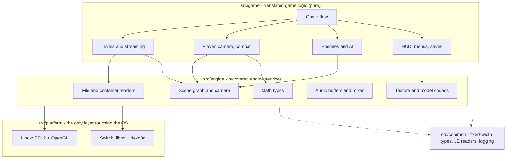
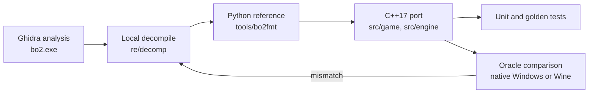

<div align="center">

# Blood Omen 2 — Native Switch Port

**A native Nintendo Switch homebrew port (libnx) of *Blood Omen 2*, built through functional decompilation of the original Windows PC release (2002, Spanish GoldMaster 1.02).**

Lee esto en español: [README.md](README.md)

**Work in progress. Milestones M0-M2 are done; M3 (playable slice) is in progress. No chapter can be completed yet.**

[![Status][status-badge]](#status)
[![Overall progress][overall-badge]](#what-the-percentages-measure)
[![Functions translated][fn-badge]](#what-the-percentages-measure)
[![Levels][levels-badge]](#what-the-percentages-measure)
[![C++17][cpp-badge]](#build)
[![CMake][cmake-badge]](#build)
[![Platforms][platform-badge]](#build)
[![License][license-badge]](#license)

[Status](#status) · [Legal](#legal-notice) · [Architecture](#architecture) · [Build](#build) · [Game data](#game-data) · [Running](#running) · [Controls](#controls) · [Methodology](#methodology) · [Docs](#documentation) · [Contributing](#contributing) · [Credits](#credits)

</div>

<!-- badges:start -->
[status-badge]: https://img.shields.io/badge/phase-M3%20in%20progress-orange
[overall-badge]: https://img.shields.io/badge/overall-8.1%25-yellow
[fn-badge]: https://img.shields.io/badge/functions-7%20%2F%2016917-lightgrey
[levels-badge]: https://img.shields.io/badge/levels-0%20%2F%2011-lightgrey
<!-- badges:end -->
[cpp-badge]: https://img.shields.io/badge/C%2B%2B-17-00599C?logo=cplusplus&logoColor=white
[cmake-badge]: https://img.shields.io/badge/build-CMake%20presets-064F8C?logo=cmake&logoColor=white
[platform-badge]: https://img.shields.io/badge/platform-Linux%20dev%20%7C%20Switch%20target-lightgrey
[license-badge]: https://img.shields.io/badge/license-TBD-red

---

## What this is

| | |
|---|---|
| **Target** | A native Nintendo Switch homebrew (`.nro`, libnx + deko3d) that reads your own copy of the game from the SD card. |
| **Development host** | Linux (SDL2 + OpenGL). The game is built, tested and compared against the original there before it reaches the console. The Switch backend has not started. |
| **Original** | The Windows PC release of *Blood Omen 2*, 1.02 Spanish GoldMaster: a 32-bit PE built with MSVC 6, Direct3D 8, DirectInput and Bink Video. |
| **Language** | The port targets that Spanish PC release: `bo2.exe` forces the Spanish locale at boot, so the original has no in-game language option and its menus are in Spanish. See [Game language](#game-language). |
| **Method** | A functional decompilation: `bo2.exe` is analysed in Ghidra, behaviour is checked against the original running as an oracle, and each function is translated to portable C++17. It is not a byte-matching rebuild. |

## Legal notice

> **This repository contains no game assets and no original game code or binaries.**
> Your game files stay on your machine, in a gitignored folder (`external/`); see [`external/README.txt`](external/README.txt) and [`docs/GAME_DATA.md`](docs/GAME_DATA.md).
> No textures, models, sounds, music, videos, executables or data containers from *Blood Omen 2* are distributed here.
> **You need your own legitimate copy of the game** to run the port (see [Game data](#game-data)).
>
> This is an independent, non-commercial preservation and interoperability project. It is **not affiliated with, endorsed by, or sponsored by** Crystal Dynamics, Eidos Interactive, Square Enix, or any other publisher or developer involved in the original game. All trademarks and game names belong to their respective owners.

CI enforces the first rule: [`scripts/check_no_assets.sh`](scripts/check_no_assets.sh) (run by [`scripts/ci.sh`](scripts/ci.sh)) fails if game files are tracked by git.

## Problem

The 2002 PC release is a 32-bit Windows game built on the engine lineage of *Mad Dash Racing*. It has no source code, no public symbols and no supported way to run on modern systems. The console releases are tied to PS2, GameCube and Xbox hardware; the PC build is the only practical decompilation target.

## Solution

1. **Host backend first**: SDL2 + OpenGL on Linux, used for development and oracle comparison.
2. **Switch backend second**: libnx + deko3d, released as a `.nro` that reads the user's own data files.

The original is used as a reference, not shipped.

## Status

**Where the project stands: M0, M1 and M2 are done and M3 is in progress.** The data pipeline, the level renderer and the oracle work. Kain walks and jumps with the original movement tuning, but combat, enemies and scripting are not translated, so **no chapter can be completed**. The numbers below are generated and measure what the port translates, not how playable it feels (see [what the percentages measure](#what-the-percentages-measure)).

<!-- progress:start -->
**Overall progress: 8.1%**

| Component | Weight | Progress | Score |
|---|---:|---:|---:|
| Functions translated / in scope | 60% | 7 / 16917 | 0.04% |
| Levels completable (campaign chapters) | 30% | 0 / 11 | 0.00% |
| Platform features | 10% | 10 / 13 + 1 partial | 80.77% |

Function map: 35519 rows: 7 translated, 19 in progress, 16891 to do, 18602 external (not game code).

The chapter list is in [`docs/LEVELS.md`](docs/LEVELS.md). Chapter flags and platform features are in [`tools/gen/progress_data.py`](tools/gen/progress_data.py).
<!-- progress:end -->

### Milestones

| Milestone | Scope | State |
|---|---|---|
| M0 | Laboratory and binary triage: hashes, PE analysis, installer container, Ghidra inventory | Done |
| M1 | Containers and assets: `.big`, `pc.rkv`, textures and models validated against the installed tree | Done |
| M2 | Host skeleton and first frame: a level renders with textures and a free camera; frame comparable to the oracle | Done |
| M3 | Playable slice: the first level playable from start to finish, route replay and state comparison | **In progress** |
| M4 | Complete systems: enemies, combat, dark gifts, scripting, menus, saves, audio, video | Not started |
| M5 | Complete content: all chapters, bosses and unlockables | Not started |
| M6 | Release: performance, handheld and docked, packaging, license decision | Not started |

Source of truth: [`STATE.md`](STATE.md) and [`ROADMAP.md`](ROADMAP.md).

### What works today

| Area | State |
|---|---|
| Asset pipeline | The installer is decoded and materialises a 227-file tree; the `.big` parser reads all 179 containers (246,332 entries) and `pc.rkv` yields 2,666 Ogg Vorbis streams; DDS textures and `game.erg` are read |
| Level rendering | A level renders headless (software rasterizer, PPM output) and in an SDL2 + OpenGL window with textures, cell grid, visibility BSP, placed instances, lights and markers parsed. Lighting is incomplete |
| Original as oracle | The pristine `bo2.exe` runs under Wine on a private Xvfb with scripted input; frames, video and Kain's state and the follow camera are read from process memory at 50 Hz. A native Windows harness is the cross-check |
| Kain in `sl01` | `bo2nx --play` walks and jumps Kain in the `sl01` level with the original movement tuning read from the `kain` data (tank turning, two-phase jump gravity, hold boost) and the run and walk-back speeds taken from the animation root motion |
| Engine foundations | Fixed-step loop, entity world with frustum culling, cell streaming, collision, third-person camera, checkpoint saves and a health and mana bar |
| Audio and input | Ogg decoding, mixer and SDL output; keyboard, controller and Switch button maps |

### What does not work yet

| Area | State |
|---|---|
| Chapters | None is completable; there is no level flow, no menus and no front end |
| Gameplay systems | Combat, enemies and AI, dark gifts, weapons and inventory, scripting and triggers are not translated. Air control, glide, analog speed and camera lag are pending |
| Animation and collision | The animation graph (`animatio`) and skinning are not decoded; the compressed collision (`collmodc`) is only extracted |
| Lighting and materials | Shared-model light maps and the material and light-map combination are open; `sl01` renders with wrong materials in some modes |
| Audio events and video | The `sound` and `strmfile` event table is not wired to gameplay; there is no Bink playback |
| Switch | The libnx and deko3d backend has not started |

### What the percentages measure

| Component | Weight | What counts |
|---|---:|---|
| Functions translated / in scope | 60% | A function counts only when the port reproduces its whole contract and a unit test pins it; code that cites an address does not count. Compiler unwind funclets and statically linked libraries (CRT, D3DX8, zlib, libpng) are excluded from the denominator. The rule is in [`tools/gen/progress_data.py`](tools/gen/progress_data.py) |
| Levels completable | 30% | One level is one of the 11 campaign chapters, recovered from the original in [`docs/LEVELS.md`](docs/LEVELS.md). It counts when the port plays it from its entry region to the next hand-off |
| Platform features | 10% | Each feature counts fully when done and half when partial |

The function share stays small on purpose: much of the port reimplements formats and tuning math, and a function is marked translated only with full coverage and a test. Many movement and animation functions are tracked as in progress.

## Architecture

Dependencies flow downward only: `game -> engine -> platform`. No SDL, OpenGL, libnx or deko3d include is allowed from `src/game/` or `src/engine/`.



The host backend exists first so the game can be built, tested and compared against the original without a console. The Switch backend ports the platform layer, not the game. Details and determinism rules: [`docs/ARCHITECTURE.md`](docs/ARCHITECTURE.md).

## Build

Requirements: CMake 3.28+, Ninja, a C++17 compiler; SDL2 and OpenGL for the window (without them the build is headless only). The Switch target will additionally need devkitPro (`switch-dev`, libnx, deko3d).

```sh
# Host development build
cmake --preset linux-debug
cmake --build --preset linux-debug
ctest --preset linux-debug --output-on-failure

# Everything, including the asset-leak check
./scripts/ci.sh
```

| Preset | Purpose |
|---|---|
| `linux-debug` | Development build |
| `linux-release` | Optimised build |
| `linux-asan` | AddressSanitizer + UBSan |

There is no Switch preset yet: the Switch backend has not started. There is no Windows build: the original game is Windows, the port is not.

## Game data

You must supply your own copy. The project targets the **PC 1.02 Spanish GoldMaster**. Hashes of the reference media and the provenance of every external artifact are in [`docs/PROVENANCE.md`](docs/PROVENANCE.md); nothing is downloaded by the build.

1. Materialize an installed copy of the game (`tools/bo2fmt/installer.py` rebuilds the tree from the installer media) so you have a directory with `data/game.erg` and `media/gogames/bo2/`.
2. Put it under `external/installed/` (gitignored).
3. Game files are never in the repository.

The Switch build will read the same layout from the SD card; the exact path is documented in [`docs/GAME_DATA.md`](docs/GAME_DATA.md) when the backend lands.

### Game language

- **The original is Spanish only.** `bo2.exe` is a Spanish Gold Master build that forces the locale `spanish` at boot (`FUN_004aae40`, called from `Game::Init`, `FUN_00515920`, before `code.big` loads). The language-choice screen (`LanguageSetupUI`) exists in the code, but this build never shows it.
- **The data ships six variants** of each localized entry. The `.big` `language` field indexes the container's name table: 0 default (an English copy), 1 English, 2 French, 3 Italian, 4 German, 5 Spanish. The localized types are `strtable` (15 per language), `lipsync` (about 11,900 per language) and 44 load-screen textures. Voices are different: `pc.rkv` holds a single Spanish section.
- **The port selects Spanish the same way.** This is work in progress.

## Running

Inspect a container, render a level to a file, or open the window:

```sh
LEVELS=external/installed/media/gogames/bo2/resources/levels
./build/linux-debug/bo2nx --list-big "$LEVELS/slums/sl01.big"
./build/linux-debug/bo2nx --level --big "$LEVELS/slums/sl01.big" --out /tmp/sl01.ppm
./build/linux-debug/bo2nx --sdl --big "$LEVELS/slums/sl01.big"
./build/linux-debug/bo2nx --play --big "$LEVELS/slums/sl01.big"   # walk Kain
```

`--play` reads the `kain` tunedata from `<levels>/kain/kain.big`. All options: [`docs/RUNNING.md`](docs/RUNNING.md).

The original game runs locally as the oracle under Wine and Xvfb: see [`docs/ORACLE_WINE.md`](docs/ORACLE_WINE.md). The native Windows harness is the cross-check: [`docs/ORACLE_WINDOWS_NATIVE.md`](docs/ORACLE_WINDOWS_NATIVE.md).

## Controls

Keyboard bindings are development defaults until the original controls are recovered; the Switch layout is a first mapping (`include/bo2/platform/input.hpp`). Combat, block, grab and dark gifts are not implemented, so they have no binding.

| Action | Keyboard | Switch / controller |
|---|---|---|
| Move forward and back | `W` / `S` or arrows | Left stick or D-pad |
| Turn in place | `A` / `D` or arrows | Left stick or D-pad |
| Run | `Shift` or `R` | `L` or `R` |
| Jump (hold for the higher jump) | `Space` | `A` |
| Attack (foundation only) | `F` | `B` |
| Use | `E` | `X` |
| Menu | `Enter` | `Y` or `Minus` |
| Pause / quit | `Escape` | `Plus` |
| Look / orbit camera (debug aid) | Right mouse drag | Right stick, `ZL` / `ZR` |

## Methodology



1. **Reverse**: Ghidra over `bo2.exe`; every behaviour claim needs a `FUN_` address and a local decompile under `re/decomp/` (gitignored).
2. **Reference**: formats and behaviours are first validated with a stdlib Python implementation (`tools/bo2fmt/`).
3. **Port**: translate faithfully; record each function in [`re/FUNCTION_MAP.csv`](re/FUNCTION_MAP.csv).
4. **Verify**: unit tests on synthetic fixtures, then the oracle: the original runs natively on Windows or under Wine, driven by scripted input, and its screenshots, state and saves are compared with the port.

Per-function loop: [`docs/PORTING_GUIDE.md`](docs/PORTING_GUIDE.md). The rule is simple: **decompile before guessing, and never ship a claim without a dump**.

## Repository layout

| Path | Contents |
|---|---|
| `src/common/` | Shared utilities (types, little-endian readers, logging) |
| `src/engine/` | Recovered engine services behind stable interfaces |
| `src/game/` | Translated game logic |
| `src/platform/sdl/` | SDL2 + OpenGL host backend |
| `src/platform/switch/` | libnx + deko3d backend (not created yet) |
| `include/bo2/` | Public headers |
| `tests/` | Unit, integration and golden tests |
| `tools/bo2fmt/` | Container and asset parsers (Python reference) and the texture exporter |
| `tools/ghidra/` | Headless Ghidra helpers |
| `tools/oracle/` | Wine capture harness, native Windows client, capture validator and aligner |
| `tools/gen/` | Progress generator and derived metadata |
| `scripts/` | CI, asset check and environment helpers |
| `re/` | Function map and local reversing artifacts (`re/decomp/` is gitignored) |
| `external/` | Your game files and the Ghidra project (gitignored; only `external/README.txt` is tracked) |
| `docs/` | Technical documentation (Markdown only) |

## Documentation

| Doc | Read it for |
|---|---|
| [`STATE.md`](STATE.md) | Current state, known unknowns and next steps (start here) |
| [`ROADMAP.md`](ROADMAP.md) | Milestones and gates |
| [`docs/ARCHITECTURE.md`](docs/ARCHITECTURE.md) | Layers, host-first strategy and determinism rules |
| [`docs/REVERSING.md`](docs/REVERSING.md) | Ghidra workflow, compiler triage and dump policy |
| [`docs/PORTING_GUIDE.md`](docs/PORTING_GUIDE.md) | The per-function translation loop |
| [`docs/FORMATS/`](docs/FORMATS/) | Container and asset format specs |
| [`docs/PRIOR_ART.md`](docs/PRIOR_ART.md) | Public tools, licenses and what we reuse or only use as an oracle |
| [`docs/LEVELS.md`](docs/LEVELS.md) | The 11 campaign chapters, their source in `bo2.exe` and the region mapping |
| [`docs/GAMEPLAY.md`](docs/GAMEPLAY.md) | Translated gameplay systems |
| [`docs/RUNNING.md`](docs/RUNNING.md) | Host build, Switch target and the oracle |
| [`docs/TESTING.md`](docs/TESTING.md) | Test pyramid and rules |
| [`docs/GAME_DATA.md`](docs/GAME_DATA.md) | Game files, layout and where they live |
| [`docs/PROVENANCE.md`](docs/PROVENANCE.md) | Hashes and chain of custody |
| [`docs/SETUP.md`](docs/SETUP.md) | One-time environment setup |
| [`docs/ORACLE_COMPARE.md`](docs/ORACLE_COMPARE.md) | Parity results against the original |
| [`docs/ORACLE_WINE.md`](docs/ORACLE_WINE.md) | Local Wine/Xvfb oracle: setup, scripted capture, game state from memory, parity |
| [`docs/ORACLE_WINDOWS_NATIVE.md`](docs/ORACLE_WINDOWS_NATIVE.md) | Native Windows capture harness, client and validation |
| [`docs/ORACLE_WINDOWS.md`](docs/ORACLE_WINDOWS.md) | Native Windows gameplay captures: facts, gaps and next steps |

## Progress tracking

- Function-level status: [`re/FUNCTION_MAP.csv`](re/FUNCTION_MAP.csv). The status block above and the badges are generated by `python3 tools/gen/progress.py` for both READMEs and checked by `scripts/ci.sh`; never edit them by hand.
- Work items are tracked in a private project tracker; the repository is the source of truth for code and docs.

## Contributing

1. Conventional Commits in English (`feat(scope):`, `fix(scope):`, `docs:`, `test(scope):`, `build(scope):`); one logical change per commit, with its tests and docs.
2. One author per commit. **No** `Co-Authored-By`, `Signed-off-by` or generated-by trailers, and no attribution inside code or docs.
3. `clang-format` before every commit; no warnings with `-Wall -Wextra -Wshadow -Wconversion`.
4. **Never commit** anything under `external/` or `re/decomp/`, or files like `.iso .exe .dll .dat .erg .rkv .big .bik .ogg .wav`. `scripts/ci.sh` checks it.
5. Fidelity first in `src/game/`: translate, do not redesign, and update `re/FUNCTION_MAP.csv`.
6. Every behaviour or format claim needs a `FUN_` address and a local decompile. If it is not proven, it does not go in.
7. Keep `README.md` (Spanish) and `README.en.md` (English) in step; code, comments, commits and the other docs stay in English.

## Credits

| Component | Use | License |
|---|---|---|
| [SDL2](https://libsdl.org) | Host window and input | zlib (system package, not vendored) |
| [stb_vorbis](https://github.com/nothings/stb) | Ogg Vorbis fallback decoder | Public domain / MIT (vendored in `third_party/`) |
| [deko3d](https://github.com/devkitPro/deko3d) | Switch renderer | zlib |
| [libnx](https://github.com/switchbrew/libnx) | Switch platform | ISC |
| [Ghidra](https://ghidra-sre.org) | Reverse engineering | Apache-2.0 |
| [Wine](https://www.winehq.org) | Oracle environment | LGPL |

Original game by Crystal Dynamics, published by Eidos Interactive. Not affiliated.

## License

**No license has been chosen yet.** The `LICENSE` file is a placeholder; no rights are granted until it is replaced. The decision is scheduled for milestone M6. The recommended option is MIT for the original code in this repository.

This license does not grant any rights to the game code, data, assets or trademarks of Crystal Dynamics, Eidos Interactive or Square Enix.
