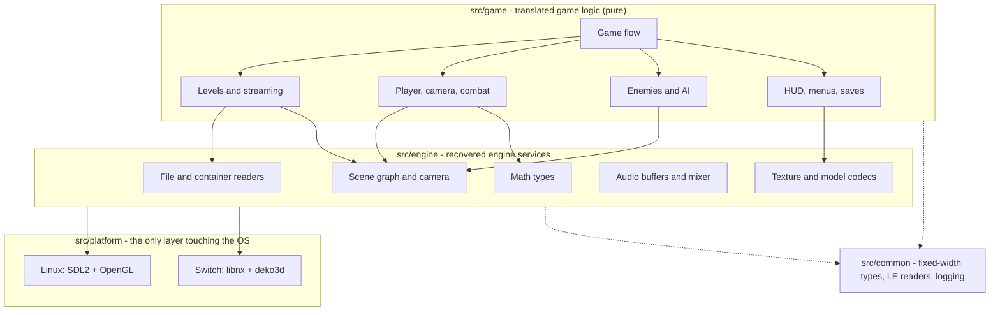
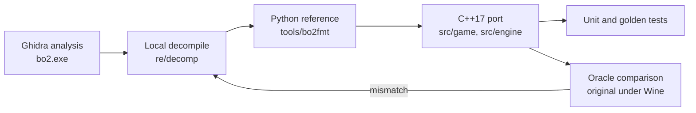

<div align="center">

# Blood Omen 2 — Native Switch Port

**A native Nintendo Switch port of *Blood Omen 2* (PC, 2002, Spanish GoldMaster 1.02), built through functional decompilation.**

**Work in progress. M1 complete; M2 (host skeleton and first frame) in progress. Nothing is playable yet.**

[![Status][status-badge]](#status)
[![Overall progress][overall-badge]](#status)
[![Functions translated][fn-badge]](#status)
[![Levels][levels-badge]](#status)
[![C++17][cpp-badge]](#build)
[![CMake][cmake-badge]](#build)
[![Platforms][platform-badge]](#build)
[![License][license-badge]](#license)

[Status](#status) · [Legal](#legal-notice) · [Architecture](#architecture) · [Build](#build) · [Game data](#game-data) · [Running](#running) · [Controls](#controls) · [Methodology](#methodology) · [Docs](#documentation) · [Contributing](#contributing) · [Credits](#credits)

</div>

[status-badge]: https://img.shields.io/badge/phase-M2%20in%20progress-orange
[overall-badge]: https://img.shields.io/badge/overall-6.2%25-yellow
[fn-badge]: https://img.shields.io/badge/functions-0%20%2F%2018097-lightgrey
[levels-badge]: https://img.shields.io/badge/levels-0%20%2F%20TBD-lightgrey
[cpp-badge]: https://img.shields.io/badge/C%2B%2B-17-00599C?logo=cplusplus&logoColor=white
[cmake-badge]: https://img.shields.io/badge/build-CMake%20presets-064F8C?logo=cmake&logoColor=white
[platform-badge]: https://img.shields.io/badge/platform-Linux%20dev%20%7C%20Switch%20target-lightgrey
[license-badge]: https://img.shields.io/badge/license-TBD-red

---

## Legal notice

> **This repository contains no game assets and no original game code or binaries.**
> Your game files stay on your machine, in a gitignored folder (`external/`); see [`external/README.txt`](external/README.txt) and [`docs/GAME_DATA.md`](docs/GAME_DATA.md).
> No textures, models, sounds, music, videos, executables or data containers from *Blood Omen 2* are distributed here.
> **You need your own legitimate copy of the game** to run the port (see [Game data](#game-data)).
>
> This is an independent, non-commercial preservation and interoperability project. It is **not affiliated with, endorsed by, or sponsored by** Crystal Dynamics, Eidos Interactive, Square Enix, or any other publisher or developer involved in the original game. All trademarks and game names belong to their respective owners.

CI enforces the first rule: [`scripts/check_no_assets.sh`](scripts/check_no_assets.sh) (run by [`scripts/ci.sh`](scripts/ci.sh)) fails if game files are tracked by git.

## Problem

The 2002 PC release is a 32-bit Windows game (Direct3D 8, DirectInput, Bink Video) built on the engine lineage of *Mad Dash Racing*. It has no source code, no public symbols and no supported way to run on modern systems. The console releases are tied to PS2, GameCube and Xbox hardware; the PC build is the only practical decompilation target.

## Solution

A **functional decompilation**: `bo2.exe` is analysed in Ghidra, formats and behaviours are verified against the original running as an oracle, and each function is translated to portable C++17. The original is used as a reference, not shipped.

The port is split so the game is testable on a desktop before it reaches the console:

1. **Host backend first**: SDL2 + OpenGL on Linux, used for development and oracle comparison.
2. **Switch backend second**: libnx + deko3d, released as a `.nro` that reads the user's own data files.

This is a *functional* port, not a byte-matching decompilation: it does not rebuild the original binary.

## Status

<!-- progress:start -->
**Overall progress: 6.2%**

| Component | Weight | Progress | Score |
|---|---:|---:|---:|
| Functions translated / in-scope | 60% | 0 / 18097 | 0.00% |
| Levels completable | 30% | 0 / TBD | 0.00% |
| Platform features | 10% | 8 / 13 | 61.54% |

Function map: 35513 rows. Levels and platform features are defined in [`tools/gen/progress_data.py`](tools/gen/progress_data.py).
<!-- progress:end -->

### What works today

| Area | State |
|---|---|
| Repository, build presets and host smoke binary | Works |
| Host backend (headless software) | First frame: real DDS texture, free camera, PPM output |
| Host backend (SDL2 + OpenGL) | Works: `bo2nx --sdl`; window, free camera and Xvfb capture |
| C++ engine readers (BIG/DDS) | Validated on the installed tree |
| Level geometry, textures and cell grid | `sanctuary` cellgrup renders headless and in OpenGL (75 models, 33/34 DDS textures, 3 cells, 33 BSP nodes, 74 placed instances) |
| Switch backend (libnx + deko3d) | Not started |
| `game.erg` | Decoded (text configuration) |
| `.big` and `pc.rkv` | Validated against the installed Spanish build: 179 `.big` (246,332 entries) and 2,666 RKV streams |
| Installer `data/*.dat` | Decoded; `tools/bo2fmt/installer.py` materializes the 227-file tree |
| Installed game tree | 227 files, 1.9 GB; manifest hash in `docs/PROVENANCE.md` |
| Level renderer, audio, input | Level shell with free-camera input; audio and gameplay pending |
| Game logic translation | Not started |
| Original game as oracle | Wine/Xvfb launches the original; frame comparison pending |

Source of truth: [`STATE.md`](STATE.md) and [`ROADMAP.md`](ROADMAP.md).

## Architecture

Dependencies flow downward only: `game -> engine -> platform`. No SDL, OpenGL, libnx or deko3d include is allowed from `src/game/` or `src/engine/`.



The host backend exists first so the game can be built, tested and compared against the original without a console. The Switch backend ports the platform layer, not the game. Details and determinism rules: [`docs/ARCHITECTURE.md`](docs/ARCHITECTURE.md).

## Build

Requirements: CMake 3.28+, Ninja, a C++17 compiler. The Switch target additionally needs devkitPro (`switch-dev`, libnx, deko3d).

```sh
# Host development build
cmake --preset linux-debug
cmake --build --preset linux-debug
ctest --preset linux-debug --output-on-failure

# Everything, including the asset-leak check
./scripts/ci.sh
```

| Preset | Purpose |
|---|---|
| `linux-debug` | Development build |
| `linux-release` | Optimised build |
| `linux-asan` | AddressSanitizer + UBSan |

The Switch preset lands with M2, once the host backend renders a level. There is no Windows build: the original game is Windows, the port is not.

## Game data

You must supply your own copy. The project targets the **PC 1.02 Spanish GoldMaster**. Hashes of the reference media and the provenance of every external artifact are in [`docs/PROVENANCE.md`](docs/PROVENANCE.md); nothing is downloaded by the build.

1. Materialize an installed copy of the game so you have a directory with `data/game.erg` and `data/`.
2. Put it under `external/installed/` (gitignored) or pass `--data-dir <dir>` when the host build supports it.
3. Game files are never in the repository.

The Switch build reads the same layout from the SD card; the exact path is documented in [`docs/GAME_DATA.md`](docs/GAME_DATA.md) when the backend lands.

## Running

The game is not runnable yet. The current binary only reports its version:

```sh
./build/linux-debug/bo2nx
```

The oracle (the original under Wine) is optional and time-boxed: see [`docs/RUNNING.md`](docs/RUNNING.md).

## Controls

The port targets a controller-first layout; the button table will be documented in [`docs/GAMEPLAY.md`](docs/GAMEPLAY.md) once the input layer exists. The original console releases are the reference for button semantics. Keyboard bindings for the host build are development-only.

| Action | Switch | Host development |
|---|---|---|
| Move | Left stick | Arrow keys |
| Camera | Right stick | Mouse / IJKL |
| Attack | TBD | TBD |
| Block | TBD | TBD |
| Grab | TBD | TBD |
| Dark gift | TBD | TBD |
| Menu / pause | `+` | Esc |

## Methodology



1. **Reverse**: Ghidra over `bo2.exe`; every behaviour claim needs a `FUN_` address and a local decompile under `re/decomp/` (gitignored).
2. **Reference**: formats and behaviours are first validated with a stdlib Python implementation (`tools/bo2fmt/`).
3. **Port**: translate faithfully; record each function in [`re/FUNCTION_MAP.csv`](re/FUNCTION_MAP.csv).
4. **Verify**: unit tests on synthetic fixtures, then the oracle: the original runs under Wine on a private Xvfb, driven by scripted input, and its screenshots, state and saves are compared with the port.

Per-function loop: [`docs/PORTING_GUIDE.md`](docs/PORTING_GUIDE.md). The rule is simple: **decompile before guessing, and never ship a claim without a dump**.

## Repository layout

| Path | Contents |
|---|---|
| `src/common/` | Shared utilities (types, little-endian readers, logging) |
| `src/engine/` | Recovered engine services behind stable interfaces |
| `src/game/` | Translated game logic |
| `src/platform/sdl/` | SDL2 + OpenGL host backend |
| `src/platform/switch/` | libnx + deko3d backend |
| `include/bo2/` | Public headers |
| `tests/` | Unit, integration and golden tests |
| `tools/bo2fmt/` | Container and asset parsers (Python reference) |
| `tools/ghidra/` | Headless Ghidra helpers |
| `tools/oracle/` | Original-under-Wine harness |
| `tools/gen/` | Progress generator and derived metadata |
| `scripts/` | CI, asset check and environment helpers |
| `re/` | Function map and local reversing artifacts (`re/decomp/` is gitignored) |
| `external/` | Your game files and the Ghidra project (gitignored; only `external/README.txt` is tracked) |
| `docs/` | Technical documentation (Markdown only) |

## Documentation

| Doc | Read it for |
|---|---|
| [`STATE.md`](STATE.md) | Current state, known unknowns and next steps (start here) |
| [`ROADMAP.md`](ROADMAP.md) | Milestones and gates |
| [`docs/ARCHITECTURE.md`](docs/ARCHITECTURE.md) | Layers, host-first strategy and determinism rules |
| [`docs/REVERSING.md`](docs/REVERSING.md) | Ghidra workflow, compiler triage and dump policy |
| [`docs/PORTING_GUIDE.md`](docs/PORTING_GUIDE.md) | The per-function translation loop |
| [`docs/FORMATS/`](docs/FORMATS/) | Container and asset format specs |
| [`docs/PRIOR_ART.md`](docs/PRIOR_ART.md) | Public tools, licenses and what we reuse or only use as an oracle |
| [`docs/GAMEPLAY.md`](docs/GAMEPLAY.md) | Translated gameplay systems |
| [`docs/RUNNING.md`](docs/RUNNING.md) | Host build, Switch target and the oracle |
| [`docs/TESTING.md`](docs/TESTING.md) | Test pyramid and rules |
| [`docs/GAME_DATA.md`](docs/GAME_DATA.md) | Game files, layout and where they live |
| [`docs/PROVENANCE.md`](docs/PROVENANCE.md) | Hashes and chain of custody |
| [`docs/SETUP.md`](docs/SETUP.md) | One-time environment setup |
| [`docs/ORACLE_COMPARE.md`](docs/ORACLE_COMPARE.md) | Parity results against the original |

## Progress tracking

- Function-level status: [`re/FUNCTION_MAP.csv`](re/FUNCTION_MAP.csv). The status block above is generated by `python3 tools/gen/progress.py` and checked by `scripts/ci.sh`; never edit it by hand.
- Work items are tracked in a private project tracker; the repository is the source of truth for code and docs.

## Contributing

1. Conventional Commits in English (`feat(scope):`, `fix(scope):`, `docs:`, `test(scope):`, `build(scope):`); one logical change per commit, with its tests and docs.
2. One author per commit. **No** `Co-Authored-By`, `Signed-off-by` or generated-by trailers, and no attribution inside code or docs.
3. `clang-format` before every commit; no warnings with `-Wall -Wextra -Wshadow -Wconversion`.
4. **Never commit** anything under `external/` or `re/decomp/`, or files like `.iso .exe .dll .dat .erg .rkv .big .bik .ogg .wav`. `scripts/ci.sh` checks it.
5. Fidelity first in `src/game/`: translate, do not redesign, and update `re/FUNCTION_MAP.csv`.
6. Every behaviour or format claim needs a `FUN_` address and a local decompile. If it is not proven, it does not go in.

## Credits

| Component | Use | License |
|---|---|---|
| [SDL2](https://libsdl.org) | Host window and input | zlib (system package, not vendored) |
| [deko3d](https://github.com/devkitPro/deko3d) | Switch renderer | zlib |
| [libnx](https://github.com/switchbrew/libnx) | Switch platform | ISC |
| [Ghidra](https://ghidra-sre.org) | Reverse engineering | Apache-2.0 |
| [Wine](https://www.winehq.org) | Oracle environment | LGPL |

Original game by Crystal Dynamics, published by Eidos Interactive. Not affiliated.

## License

**No license has been chosen yet.** The `LICENSE` file is a placeholder; no rights are granted until it is replaced. The decision is scheduled for milestone M6. The recommended option is MIT for the original code in this repository.

This license does not grant any rights to the game code, data, assets or trademarks of Crystal Dynamics, Eidos Interactive or Square Enix.
