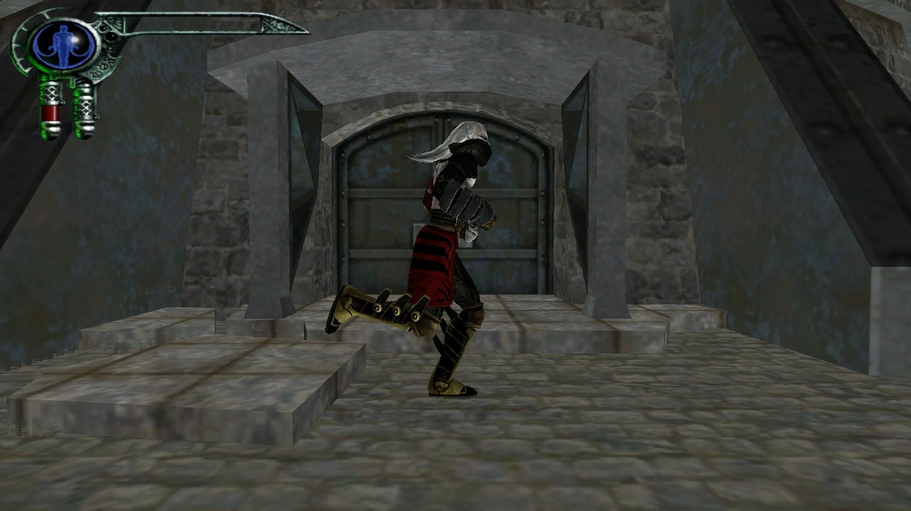
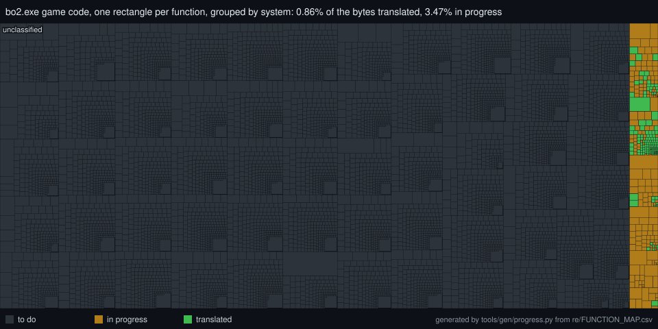
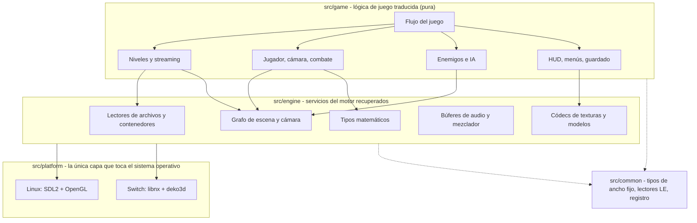
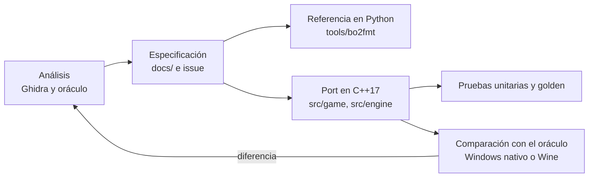

<div align="center">

# Blood Omen 2 — Port nativo para Switch

**Port nativo homebrew de *Blood Omen 2* para Nintendo Switch (libnx), construido mediante ingeniería inversa del lanzamiento original de PC para Windows (2002, GoldMaster 1.02 en español).**

English version: [README.en.md](README.en.md)

**Trabajo en curso. Los hitos M0 y M1 están completos; M3 (porción jugable) es la fase actual, y M2 y M4 también tienen tareas abiertas. Todavía no se puede completar ningún capítulo.**

[![Estado][status-badge]](#estado)
[![Progreso global][overall-badge]](#qué-miden-los-porcentajes)
[![Funciones traducidas][fn-badge]](#qué-miden-los-porcentajes)
[![Niveles][levels-badge]](#qué-miden-los-porcentajes)
[![C++17][cpp-badge]](#compilar)
[![CMake][cmake-badge]](#compilar)
[![Plataformas][platform-badge]](#compilar)
[![Licencia][license-badge]](#licencia)

[Página de progreso](https://felipesuarez-dev.github.io/BloodOmen2NX/) · [Estado](#estado) · [Aviso legal](#aviso-legal) · [Arquitectura](#arquitectura) · [Compilar](#compilar) · [Datos del juego](#datos-del-juego) · [Ejecutar](#ejecutar) · [Controles](#controles) · [Metodología](#metodología) · [Documentación](#documentación) · [Contribuir](#contribuir) · [Créditos](#créditos)

</div>

<!-- badges:start -->
[status-badge]: https://img.shields.io/badge/fase-M3%20en%20curso-orange
[overall-badge]: https://img.shields.io/badge/global-9.2%25-yellow
[fn-badge]: https://img.shields.io/badge/funciones-373%20%2F%2017118-lightgrey
[levels-badge]: https://img.shields.io/badge/niveles-0%20%2F%2011-lightgrey
<!-- badges:end -->
[cpp-badge]: https://img.shields.io/badge/C%2B%2B-17-00599C?logo=cplusplus&logoColor=white
[cmake-badge]: https://img.shields.io/badge/build-CMake%20presets-064F8C?logo=cmake&logoColor=white
[platform-badge]: https://img.shields.io/badge/plataforma-Linux%20desarrollo%20%7C%20Switch%20destino-lightgrey
[license-badge]: https://img.shields.io/badge/licencia-GPL--3.0--or--later-blue

---

<p align="center"></p>
<p align="center"><sub>Kain corriendo en <code>sl01</code>, dibujado por el port (renderizador por software) con su modelo, su animación y el HUD del original, a partir de los datos de una copia original.</sub></p>

## Qué es esto

| | |
|---|---|
| **Destino** | Un homebrew nativo para Nintendo Switch (`.nro`, libnx + deko3d) que lee tu propia copia del juego desde la tarjeta SD. |
| **Host de desarrollo** | Linux (SDL2 + OpenGL). El juego se compila, se prueba y se compara con el original ahí antes de llegar a la consola. El backend de Switch todavía no se ha iniciado. |
| **Original** | El lanzamiento de PC para Windows de *Blood Omen 2*, GoldMaster 1.02 en español: un PE de 32 bits compilado con MSVC 6, con Direct3D 8, DirectInput y Bink Video. |
| **Idioma** | El port está pensado para los cinco idiomas que traen los datos del juego: inglés, francés, italiano, alemán y español. Hoy arranca en español, como el `bo2.exe` original, y el idioma se elige con `--locale`. Ya lee las tablas de texto, la fuente y los códigos de acentos de los cinco idiomas, separa y coloca los glifos de un texto como el original, y el menú principal ya se dibuja con `--menu-text`; faltan el resto de los textos, las voces por idioma y la pantalla de elección de idioma. Consulta [Idioma del juego](#idioma-del-juego). |
| **Método** | Ingeniería inversa para la compatibilidad: `bo2.exe` se analiza en Ghidra y el comportamiento se contrasta con el original ejecutándose como oráculo; lo aprendido se escribe como especificación en `docs/` y el código C++17 portable se escribe desde esa especificación. No es una reconstrucción byte a byte. Consulta [`docs/PROVENANCE.md`](docs/PROVENANCE.md). |

## Aviso legal

Este port es un proyecto de aficionados, independiente y sin fines de lucro, hecho con fines de preservación e interoperabilidad. No está afiliado a Crystal Dynamics, Eidos Interactive ni Square Enix, ni cuenta con su respaldo o patrocinio. *Blood Omen 2*, *Legacy of Kain* y los demás nombres y marcas relacionados pertenecen a sus respectivos dueños.

Este repositorio contiene solo el código escrito para el proyecto y su documentación. **No incluye el juego**: ni sus ejecutables, ni su código, ni gráficos, modelos, sonidos, música, videos o archivos de datos. La única imagen es la captura de arriba, dibujada por el port, como ilustración. Tampoco los incluirá cuando el port sea jugable; lo que se publique será únicamente el programa.

Para usar el port hace falta una copia original de la versión para PC de *Blood Omen 2*, obtenida de forma legal. El port lee los archivos de esa copia en el propio equipo o consola de quien lo usa, sin modificarlos ni compartirlos. En [Datos del juego](#datos-del-juego) y en [`docs/GAME_DATA.md`](docs/GAME_DATA.md) se explica qué archivos necesita y dónde van.

El funcionamiento del juego original se estudia solo para que el port sea compatible con él: lo aprendido se describe primero en `docs/` y el código se escribe a partir de esa descripción. El método completo está en [`docs/PROVENANCE.md`](docs/PROVENANCE.md).

## Problema

El lanzamiento de PC de 2002 es un juego de Windows de 32 bits construido sobre la misma familia de motor que *Mad Dash Racing*. No tiene código fuente, ni símbolos públicos, ni una forma oficial de ejecutarse en sistemas modernos. Las versiones de consola están atadas al hardware de PS2, GameCube y Xbox; la versión de PC es el único objetivo práctico de decompilación.

## Solución

1. **Primero el backend de host**: SDL2 + OpenGL en Linux, para desarrollo y comparación con el oráculo.
2. **Después el backend de Switch**: libnx + deko3d, publicado como un `.nro` que lee los archivos de datos del propio usuario.

El original se usa como referencia; no se distribuye.

## Estado

**Dónde está el proyecto: M0 y M1 están completos; M3 es la fase actual. M2 cumplió su criterio de cierre pero le quedan cinco tareas, y M4 ya avanza.** La canalización de datos, el renderizador de niveles y el oráculo funcionan. Kain camina, corre y salta (con control en el aire) con los ajustes de movimiento originales y el port elige el español como el original. La máquina que ejecuta los scripts del juego está portada, pero todavía no corre los scripts de un nivel, y el combate y los enemigos no están traducidos, así que **no se puede completar ningún capítulo**. Los números de abajo se generan y miden lo que el port traduce, no qué tan jugable se siente (consulta [qué miden los porcentajes](#qué-miden-los-porcentajes)).

<!-- progress:start -->
**Progreso global: 9.2%**

| Componente | Peso | Avance | Puntaje |
|---|---:|---:|---:|
| Funciones traducidas / en alcance | 60% | 373 / 17 118 | 2.18% |
| Niveles completables (capítulos de la campaña) | 30% | 0 / 11 | 0.00% |
| Características de plataforma | 10% | 9 / 12 + 1 parcial | 79.17% |

Mapa de funciones: 35 720 filas: 373 traducidas, 242 en curso, 16 503 pendientes, 18 602 externas (no son código del juego).



La lista de capítulos está en [`docs/LEVELS.md`](docs/LEVELS.md). Los capítulos completables y las características de plataforma se definen en [`tools/gen/progress_data.py`](tools/gen/progress_data.py).
<!-- progress:end -->

### Hitos

| Hito | Alcance | Estado |
|---|---|---|
| M0 | Laboratorio y triaje del binario: hashes, análisis del PE, contenedor del instalador, inventario de Ghidra | Completo |
| M1 | Contenedores y recursos: `.big`, `pc.rkv`, texturas y modelos validados contra el árbol instalado | Completo |
| M2 | Esqueleto del host y primer fotograma: un nivel se renderiza con texturas y cámara libre; fotograma comparable con el oráculo | En curso: el criterio de cierre se cumplió el 29-10-2026; quedan cinco tareas (materiales de `sl01`, colores por vértice y lo que rechaza el verificador de datos) |
| M3 | Porción jugable: el primer nivel jugable de principio a fin, repetición de ruta y comparación de estado | **En curso (fase actual)** |
| M4 | Sistemas completos: enemigos, combate, dotes oscuras, scripts, menús, guardado, audio, video | En curso: la máquina de scripts y el texto del menú avanzan |
| M5 | Contenido completo: todos los capítulos, jefes y desbloqueables | Sin iniciar |
| M6 | Lanzamiento: rendimiento, modo portátil y dock, empaquetado | Sin iniciar |

Fuente de verdad: [`STATE.md`](STATE.md) y [`ROADMAP.md`](ROADMAP.md) (en inglés).

### Qué funciona hoy

| Área | Estado |
|---|---|
| Canalización de recursos | El port lee el árbol que deja el instalador oficial (227 archivos); el parser de `.big` lee los 179 contenedores (246 332 entradas) y `pc.rkv` entrega 2666 flujos Ogg Vorbis; se leen las texturas DDS y `game.erg`. `bo2nx_check_data` pasa cada lector del port por los 179 contenedores y lo que rechaza queda en [`docs/DATA_COVERAGE.md`](docs/DATA_COVERAGE.md) |
| Renderizado de niveles | Un nivel se renderiza sin ventana (rasterizador por software, salida PPM) y en una ventana SDL2 + OpenGL, con texturas, cuadrícula de celdas, BSP de visibilidad, instancias colocadas, luces y marcadores analizados. Los objetos auxiliares (`flag helperobj` en su plantilla `.etp`) se ocultan como en el original. La iluminación está incompleta |
| Original como oráculo | El `bo2.exe` intacto se ejecuta bajo Wine en un Xvfb privado con entrada guiada por script. Los fotogramas y el video se capturan del Xvfb (x11grab a 30 fps); el estado de Kain, su animación y la cámara de seguimiento se leen de la memoria del proceso cada 20 ms. Un arnés nativo de Windows sirve de verificación cruzada |
| Reproducción del oráculo y comparación de estado | El port reproduce el timeline de entrada de una captura Wine y compara el estado del jugador, la cámara y la velocidad frame a frame. El spawn coincide dentro de 0,05 u y se miden las primeras divergencias de W y salto |
| Kain en `sl01` | `bo2nx --play` hace caminar, correr y saltar a Kain en el nivel `sl01` con los ajustes de movimiento originales leídos de los datos de `kain` (giro tipo tanque, gravedad de salto en dos fases, impulso al mantener el salto, control en el aire y stick parcial) y con las velocidades de carrera y de retroceso tomadas del movimiento de raíz de las animaciones y del grafo de animación. La cámara sigue el giro con aceleración limitada, recupera el rango tras una colisión y se retrasa en altura al saltar, como en el original. Con `--kain-model` se dibuja el modelo de Kain con su esqueleto: los clips `animreel` posan los 104 huesos y el skinning mueve los 1988 vértices. En `--replay` y `--play` el clip lo elige la máquina de estados del grafo de animación según el movimiento (reposo, carrera, retroceso, salto y aterrizaje); el estado coincide con el del original en el 96,4 % y el 99,9 % de las muestras de dos capturas del oráculo |
| Scripts del juego | El port lee los 480 paquetes de scripts compilados y el paquete de cada una de las 165 regiones, y los enlaza en un programa por región (81 752 clases en total). Su máquina ejecuta, como la del original, todas las instrucciones que usan los datos: valores, aritmética, saltos, llamadas, hilos hijos, objetos con sus valores iniciales y sus estados, y cuatro tipos de valor. La prueban tests con código sintético; todavía no corre los objetos de un nivel ([`docs/SCRIPTS.md`](docs/SCRIPTS.md)) |
| Texto e idiomas | Se leen las tablas de texto (`strtable`) de los cinco idiomas, la fuente del juego (87 glifos) y los códigos de acentos de cada idioma. Los comandos de un texto y la colocación de sus glifos están portados como en el original ([`docs/TEXT.md`](docs/TEXT.md)) |
| Base del motor | Bucle de paso fijo, mundo de entidades con descarte por frustum, carga por celdas, colisión, cámara en tercera persona, guardado en puntos de control y una barra de salud y maná |
| Audio y entrada | Decodificación Ogg, mezclador y salida por SDL; mapas de teclado, de control y de botones de Switch |

### Qué no funciona todavía

| Área | Estado |
|---|---|
| Capítulos | Ninguno se puede completar; no hay flujo de niveles, ni menús, ni pantalla de inicio. El menú principal ya se dibuja en los cinco idiomas con `--menu-text`, comprobado contra el juego original ([`docs/TEXT.md`](docs/TEXT.md)) |
| Sistemas de juego | El combate, los enemigos y la IA, los dotes oscuras, las armas y el inventario, y los disparadores no están traducidos. Ningún script de un nivel corre todavía: faltan las 505 funciones nativas que conectan los scripts con el juego y los tipos de valor que no son de posición, rotación, color ni cuadrícula (sonidos, puntos de ruta, criaturas). Faltan el planeo y la caída desde bordes |
| Texto en pantalla | El menú principal ya se dibuja en los cinco idiomas con `--menu-text`; faltan el HUD, los diálogos y el resto de los menús, las voces por idioma y la pantalla de elección de idioma (`LanguageSetupUI`) |
| Animación y colisión | La evaluación del esqueleto, el skinning y la máquina de estados del grafo de animación (`animatio`) están portados para una capa. También están portadas la mezcla de poses entre clips, sin los filtros de transición, y las capas de la carrera con la mezcla caminar/correr según el stick. El modo combate (Shift) reproduce el movimiento de combate del grafo. Faltan la inclinación al girar, las máscaras de capa, los eventos de los clips y los ataques. La colisión está portada: el `collmodc` se decodifica (puntos, triángulos empaquetados, esferas y caras), `CollisionWorld` usa el hull exacto y el gestor de colisión barre la esfera del cuerpo de Kain. La carrera de W en `sl01` desliza a 162 u/s por el chaflán del modelo 57 y frena en x = 326,38, y = 44,18 (oráculo: 326,35 / 44,14) |
| Iluminación y materiales | El palette de `.slm` es un mapa de sombra; en el punto de inicio de `sl01` el error del mundo es 8,69/255. El HUD del original ya se dibuja sobre el frame del nivel y en la ventana de `--play` (marco, vial de salud, vial de lore, barra de furia y el icono del dark gift con el que empieza Kain), pero sus contadores todavía no cambian. Quedan la iluminación de Kain, el marcador verde `bo2cinematic001` y el formato exacto de textura del palette; la niebla está desactivada en `sl01` |
| Eventos de audio y video | La tabla de eventos `sound` y `strmfile` no está conectada al juego; no hay reproducción de Bink |
| Switch | El backend libnx y deko3d no se ha iniciado |

### Qué miden los porcentajes

| Componente | Peso | Qué cuenta |
|---|---:|---|
| Funciones traducidas / en alcance | 60% | Una función cuenta solo cuando el port reproduce todo su contrato y una prueba unitaria lo respalda; el código que solo cita una dirección no cuenta. Los fragmentos de desenrollado de pila del compilador y las bibliotecas enlazadas estáticamente ya identificadas (CRT, D3DX8, zlib, libpng) quedan fuera del denominador. La regla está en [`tools/gen/progress_data.py`](tools/gen/progress_data.py) |
| Niveles completables | 30% | Un nivel es uno de los 11 capítulos de la campaña, recuperados del original en [`docs/LEVELS.md`](docs/LEVELS.md). Cuenta cuando el port lo juega desde su región de entrada hasta el siguiente traspaso |
| Características de plataforma | 10% | Cada característica cuenta completa cuando está lista y a la mitad cuando es parcial |

La parte de funciones es pequeña a propósito: gran parte del port reimplementa formatos y cálculos de los ajustes, y una función se marca como traducida solo con cobertura completa y una prueba. Las funciones en curso, que el port cubre solo en parte, no suman.

Por eso el porcentaje global sube despacio. Cada función traducida suma unos 0,0035 puntos (el 60 % repartido entre casi 17 000 funciones), cada capítulo completable suma 2,7 puntos y cada característica de plataforma 0,8. El trabajo en curso se ve en ámbar en el mapa del código, no en el porcentaje.

## Arquitectura

Las dependencias solo fluyen hacia abajo: `game -> engine -> platform`. No se permite ningún include de SDL, OpenGL, libnx ni deko3d desde `src/game/` ni `src/engine/`.



El backend de host existe primero para poder compilar, probar y comparar el juego con el original sin una consola. El backend de Switch porta la capa de plataforma, no el juego. Detalles y reglas de determinismo: [`docs/ARCHITECTURE.md`](docs/ARCHITECTURE.md).

## Compilar

Requisitos: CMake 3.28+, Ninja y un compilador C++17; SDL2 y OpenGL para la ventana (sin ellos la compilación es solo sin ventana). El destino Switch necesitará además devkitPro (`switch-dev`, libnx, deko3d).

```sh
# Compilación de desarrollo en el host
cmake --preset linux-debug
cmake --build --preset linux-debug
ctest --preset linux-debug --output-on-failure

# Todo, incluida la verificación de que no se rastreen archivos del juego
./scripts/ci.sh
```

| Preset | Propósito |
|---|---|
| `linux-debug` | Compilación de desarrollo |
| `linux-release` | Compilación optimizada |
| `linux-asan` | AddressSanitizer + UBSan |

Todavía no hay un preset de Switch: el backend de Switch no se ha iniciado. No hay compilación para Windows: el juego original es de Windows, el port no.

## Datos del juego

Debes aportar tu propia copia. El proyecto apunta al **PC 1.02 GoldMaster en español** (la versión sale de `data/version.raw`; consulta [`docs/PROVENANCE.md`](docs/PROVENANCE.md)). Los hashes de los medios de referencia y la procedencia de cada artefacto externo están en [`docs/PROVENANCE.md`](docs/PROVENANCE.md); la compilación no descarga nada.

1. Instala el juego con su instalador oficial, en Windows o con Wine, para tener un directorio con `data/game.erg` y `media/gogames/bo2/`. El repositorio no trae ninguna herramienta para extraer el instalador.
2. Colócala en `external/installed/` (ignorado por git).
3. Los archivos del juego nunca están en el repositorio.

La compilación para Switch leerá la misma estructura desde la tarjeta SD; la ruta exacta se documentará en [`docs/GAME_DATA.md`](docs/GAME_DATA.md) cuando llegue el backend.

### Idioma del juego

- **El ejecutable original fuerza el español.** `bo2.exe` es una compilación GoldMaster en español que fuerza la configuración regional `spanish` al arrancar (`FUN_004aae40`, llamada desde `Game::Init`, `FUN_00515920`, antes de que se cargue `code.big`). La pantalla de elección de idioma (`LanguageSetupUI`) existe en el código, pero esta compilación nunca la muestra.
- **Los datos incluyen hasta seis variantes** de cada entrada localizada. El campo `language` de un `.big` es un índice en la tabla de nombres del contenedor: 0 predeterminado (una copia en inglés), 1 inglés, 2 francés, 3 italiano, 4 alemán, 5 español. Los tipos localizados son `strtable` (15 por idioma), `lipsync` (unas 11 900 por idioma) y 44 texturas de pantallas de carga (solo en francés, italiano, alemán y español, más la copia predeterminada). Las voces son distintas: `pc.rkv` contiene un solo idioma, el español, con 2433 voces.
- **El port elige el idioma con `--locale`** (`english`, `french`, `italian`, `german` o `spanish`; sin la opción, `spanish`): al buscar un recurso localizado toma la entrada de ese idioma y, si no existe, la copia predeterminada (`FUN_006c8fb0`). Las tablas de texto, la fuente y los códigos de acentos ya se leen, y los comandos de un texto y la colocación de sus glifos están portados; el menú principal ya dibuja sus cinco ítems con `--menu-text`, y el HUD y el resto de los textos todavía no.
- **Plan multiidioma.** El port no quedará atado al español. Falta dibujar el texto con la fuente y los acentos de cada idioma, elegir las voces y el lipsync por idioma y portar la pantalla de elección de idioma del original (`LanguageSetupUI`); en Switch el idioma inicial será el de la consola. Con los datos de este lanzamiento las voces solo están en español: las de otro idioma tendrán que venir del `pc.rkv` de tu propia copia de otra edición de PC.

## Ejecutar

Inspecciona un contenedor, renderiza un nivel a un archivo o abre la ventana:

```sh
LEVELS=external/installed/media/gogames/bo2/resources/levels
./build/linux-debug/bo2nx --list-big "$LEVELS/slums/sl01.big"
./build/linux-debug/bo2nx --level --big "$LEVELS/slums/sl01.big" --out /tmp/sl01.ppm
./build/linux-debug/bo2nx --sdl --big "$LEVELS/slums/sl01.big"
./build/linux-debug/bo2nx --play --big "$LEVELS/slums/sl01.big"   # camina con Kain
./build/linux-debug/bo2nx --collision-dump --big "$LEVELS/sanctuary/sanctuary.big" --collision-out /tmp/collisions.txt
```

`--play` lee los datos de ajuste de `kain` desde `<directorio del nivel>/../kain/kain.big` (para `sl01`, `resources/levels/kain/kain.big`). Todas las opciones: [`docs/RUNNING.md`](docs/RUNNING.md).

El juego original se ejecuta localmente como oráculo bajo Wine y Xvfb: consulta [`docs/ORACLE_WINE.md`](docs/ORACLE_WINE.md). El arnés nativo de Windows es la verificación cruzada: [`docs/ORACLE_WINDOWS_NATIVE.md`](docs/ORACLE_WINDOWS_NATIVE.md).

## Controles

Las teclas son valores de desarrollo hasta que se recuperen los controles originales; la disposición de Switch es una primera asignación (`include/bo2/platform/input.hpp`). El combate, el bloqueo, el agarre y los dotes oscuras no están implementados, así que no tienen asignación.

| Acción | Teclado | Switch / control |
|---|---|---|
| Avanzar y retroceder | `W` / `S` o flechas | Stick izquierdo o cruceta |
| Girar en el lugar | `A` / `D` o flechas | Stick izquierdo o cruceta |
| Modo combate (mantener) | `Shift` o `R` | `L` o `R` |
| Saltar (mantén para el salto más alto) | `Espacio` | `A` |
| Atacar (marcador de prueba; el combate no está portado) | `F` | `B` |
| Usar (asignado, todavía sin uso) | `E` | `X` |
| Menú (asignado, todavía sin uso) | `Enter` | `Y` o `Menos` |
| Guardar / cargar el punto de control | `F5` / `F9` | — |
| Pausa / salir | `Escape` | `Más` |
| Mirar / orbitar la cámara (ayuda de depuración) | Arrastrar con el botón derecho | Stick derecho, `ZL` / `ZR` |

## Metodología



1. **Analizar**: Ghidra sobre `bo2.exe` y el juego en ejecución como oráculo; toda afirmación de comportamiento necesita la dirección `FUN_` donde se observó. Las decompilaciones quedan locales en `re/decomp/` (ignorado por git).
2. **Especificar**: la regla, el formato y los números que un test puede comprobar se escriben en `docs/` y en un issue. Los formatos se validan además con una referencia en Python con solo biblioteca estándar (`tools/bo2fmt/`).
3. **Implementar**: el código se escribe desde la especificación, sin abrir el binario ni las decompilaciones; reproduce el comportamiento y los datos que documenta, con estructura y nombres propios. Cada función queda registrada en [`re/FUNCTION_MAP.csv`](re/FUNCTION_MAP.csv).
4. **Verificar**: pruebas unitarias con datos sintéticos y luego el oráculo: el original se ejecuta de forma nativa en Windows o bajo Wine, con entrada guiada por script, y sus capturas, estado y partidas guardadas se comparan con el port.

Ciclo completo: [`docs/PORTING_GUIDE.md`](docs/PORTING_GUIDE.md); política de procedencia: [`docs/PROVENANCE.md`](docs/PROVENANCE.md). La regla es simple: **analiza antes de suponer y no afirmes nada sin la función donde se observa**.

## Estructura del repositorio

| Ruta | Contenido |
|---|---|
| `src/common/` | Utilidades compartidas (tipos, lectores little-endian, registro) |
| `src/engine/` | Servicios del motor recuperados tras interfaces estables |
| `src/game/` | Lógica de juego traducida |
| `src/platform/sdl/` | Backend de host SDL2 + OpenGL |
| `src/platform/switch/` | Backend libnx + deko3d (aún no creado) |
| `include/bo2/` | Cabeceras públicas |
| `tests/` | Pruebas unitarias, de integración y golden |
| `tools/bo2fmt/` | Parsers de contenedores y recursos (referencia en Python) y el exportador de texturas |
| `tools/ghidra/` | Utilidades de Ghidra sin interfaz |
| `tools/oracle/` | Arnés de captura con Wine, cliente nativo de Windows, validador de capturas y alineador |
| `tools/gen/` | Generador de progreso y metadatos derivados |
| `scripts/` | CI, verificación de recursos y utilidades de entorno |
| `re/` | Mapa de funciones y artefactos locales de ingeniería inversa (`re/decomp/` está ignorado por git) |
| `external/` | Tus archivos del juego y el proyecto de Ghidra (ignorado por git; solo `external/README.txt` se rastrea) |
| `docs/` | Documentación técnica (solo Markdown, en inglés) |

## Documentación

La documentación técnica está en inglés.

| Documento | Para qué sirve |
|---|---|
| [`STATE.md`](STATE.md) | Estado actual, incógnitas conocidas y próximos pasos (empieza aquí) |
| [`ROADMAP.md`](ROADMAP.md) | Hitos y criterios de paso |
| [`docs/ARCHITECTURE.md`](docs/ARCHITECTURE.md) | Capas, estrategia de host primero y reglas de determinismo |
| [`docs/REVERSING.md`](docs/REVERSING.md) | Flujo de trabajo con Ghidra, triaje del compilador y política de volcados |
| [`docs/PORTING_GUIDE.md`](docs/PORTING_GUIDE.md) | Del análisis a la especificación y de la especificación al código |
| [`docs/FORMATS/`](docs/FORMATS/) | Especificaciones de formatos de contenedores y recursos |
| [`docs/PRIOR_ART.md`](docs/PRIOR_ART.md) | Herramientas públicas, licencias y qué reutilizamos o solo usamos como oráculo |
| [`docs/LEVELS.md`](docs/LEVELS.md) | Los 11 capítulos de la campaña, su fuente en `bo2.exe` y la correspondencia con las regiones |
| [`docs/GAMEPLAY.md`](docs/GAMEPLAY.md) | Sistemas de juego traducidos |
| [`docs/HUD.md`](docs/HUD.md) | El HUD: proyección, visibilidad y reglas de las barras |
| [`docs/TEXT.md`](docs/TEXT.md) | El texto: comandos de una cadena y colocación de los glifos |
| [`docs/SCRIPTS.md`](docs/SCRIPTS.md) | Los scripts: objetos, estados, hilos y las instrucciones de su máquina |
| [`docs/RUNNING.md`](docs/RUNNING.md) | Compilación del host, destino Switch y el oráculo |
| [`docs/TESTING.md`](docs/TESTING.md) | Pirámide de pruebas y reglas |
| [`docs/GAME_DATA.md`](docs/GAME_DATA.md) | Archivos del juego, estructura y dónde viven |
| [`docs/PROVENANCE.md`](docs/PROVENANCE.md) | Hashes y cadena de custodia |
| [`docs/SETUP.md`](docs/SETUP.md) | Configuración única del entorno |
| [`docs/ORACLE_COMPARE.md`](docs/ORACLE_COMPARE.md) | Resultados de paridad con el original |
| [`docs/ORACLE_WINE.md`](docs/ORACLE_WINE.md) | Oráculo local con Wine/Xvfb: preparación, captura guiada, estado del juego desde memoria, paridad |
| [`docs/ORACLE_WINDOWS_NATIVE.md`](docs/ORACLE_WINDOWS_NATIVE.md) | Arnés de captura nativo de Windows, cliente y validación |
| [`docs/ORACLE_WINDOWS.md`](docs/ORACLE_WINDOWS.md) | Capturas de juego nativas de Windows: hechos, brechas y próximos pasos |

## Seguimiento del progreso

- Página de progreso: [https://felipesuarez-dev.github.io/BloodOmen2NX/](https://felipesuarez-dev.github.io/BloodOmen2NX/), generada con los mismos números que el bloque de estado.
- Estado por función: [`re/FUNCTION_MAP.csv`](re/FUNCTION_MAP.csv). El bloque de estado de arriba y las insignias se generan con `python3 tools/gen/progress.py` para ambos README y los verifica `scripts/ci.sh`; nunca los edites a mano.
- Los elementos de trabajo se siguen en un gestor de proyectos privado; el repositorio es la fuente de verdad del código y la documentación.

## Contribuir

1. Conventional Commits en inglés (`feat(scope):`, `fix(scope):`, `docs:`, `test(scope):`, `build(scope):`); un cambio lógico por commit, con sus pruebas y documentación.
2. Un solo autor por commit. **Nada** de `Co-Authored-By`, `Signed-off-by` ni trailers de generación, y ninguna atribución dentro del código o la documentación.
3. Ejecuta `clang-format` antes de cada commit; sin advertencias con `-Wall -Wextra -Wshadow -Wconversion`.
4. **Nunca subas** nada de `external/` o `re/decomp/`, ni archivos como `.iso .exe .dll .dat .erg .rkv .big .bik .ogg .wav`, ni imágenes del juego. [`scripts/check_no_assets.sh`](scripts/check_no_assets.sh), que corre dentro de `scripts/ci.sh`, lo verifica.
5. Primero la fidelidad en `src/game/`: reproduce el comportamiento documentado, no lo rediseñes, y actualiza `re/FUNCTION_MAP.csv`.
6. Toda afirmación de comportamiento o de formato necesita una dirección `FUN_` y una decompilación local. Si no está demostrada, no entra.
7. Mantén `README.md` (español) y `README.en.md` (inglés) sincronizados; el código, los comentarios, los commits y el resto de la documentación siguen en inglés.

## Créditos

| Componente | Uso | Licencia |
|---|---|---|
| [SDL2](https://libsdl.org) | Ventana y entrada del host | zlib (paquete del sistema, no incluido) |
| [stb_vorbis](https://github.com/nothings/stb) | Decodificador Ogg Vorbis de respaldo | Dominio público / MIT (incluido en `third_party/`) |
| [deko3d](https://github.com/devkitPro/deko3d) | Renderizador de Switch | zlib |
| [libnx](https://github.com/switchbrew/libnx) | Plataforma Switch | ISC |
| [Ghidra](https://ghidra-sre.org) | Ingeniería inversa | Apache-2.0 |
| [Wine](https://www.winehq.org) | Entorno del oráculo | LGPL |

Juego original de Crystal Dynamics, publicado por Eidos Interactive. Sin afiliación.

## Menciones

- [Awesome REA](https://awesome-rea.com/resources/bloodomen2nx-case/): caso de estudio «Blood Omen 2: functional decompilation toward a Switch port».

## Licencia

El código y la documentación originales de este repositorio se publican bajo la **GNU General Public License, versión 3 o posterior** (`GPL-3.0-or-later`). El texto completo está en [`LICENSE`](LICENSE).

Copyright (C) 2026 felipesuarez-dev y colaboradores.

- Puedes usar, estudiar, modificar y redistribuir el programa. Si distribuyes una versión modificada o un binario, tienes que ofrecer su código fuente bajo la misma licencia.
- El programa se entrega sin ninguna garantía.
- `third_party/stb_vorbis.c` conserva su propia licencia (dominio público / MIT). El alcance de la licencia y los créditos de terceros están en [`NOTICE`](NOTICE).
- **No se publican binarios del port** (ni `.nro` ni ejecutables) antes de una revisión legal. La política de procedencia del código está en [`docs/PROVENANCE.md`](docs/PROVENANCE.md).

La licencia cubre solo el trabajo original de los autores de este repositorio. **No concede ningún derecho** sobre *Blood Omen 2*: su código, sus datos, sus recursos, sus nombres y sus marcas pertenecen a sus propietarios (Crystal Dynamics, Eidos Interactive, Square Enix o sus sucesores).
