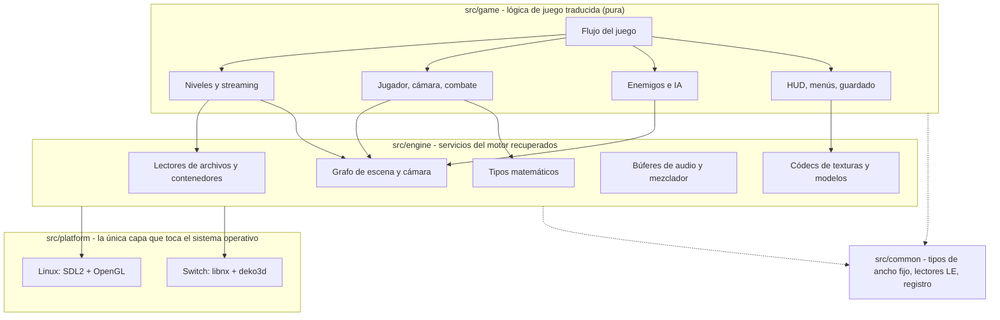
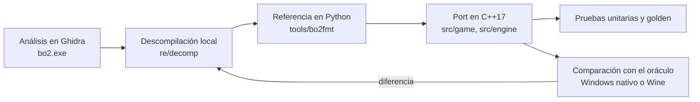

<div align="center">

# Blood Omen 2 — Port nativo para Switch

**Port nativo homebrew de *Blood Omen 2* para Nintendo Switch (libnx), construido mediante descompilación funcional del lanzamiento original de PC para Windows (2002, GoldMaster 1.02 en español).**

English version: [README.en.md](README.en.md)

**Trabajo en curso. Los hitos M0-M2 están completos; M3 (porción jugable) está en curso. Todavía no se puede completar ningún capítulo.**

[![Estado][status-badge]](#estado)
[![Progreso global][overall-badge]](#qué-miden-los-porcentajes)
[![Funciones traducidas][fn-badge]](#qué-miden-los-porcentajes)
[![Niveles][levels-badge]](#qué-miden-los-porcentajes)
[![C++17][cpp-badge]](#compilar)
[![CMake][cmake-badge]](#compilar)
[![Plataformas][platform-badge]](#compilar)
[![Licencia][license-badge]](#licencia)

[Estado](#estado) · [Aviso legal](#aviso-legal) · [Arquitectura](#arquitectura) · [Compilar](#compilar) · [Datos del juego](#datos-del-juego) · [Ejecutar](#ejecutar) · [Controles](#controles) · [Metodología](#metodología) · [Documentación](#documentación) · [Contribuir](#contribuir) · [Créditos](#créditos)

</div>

<!-- badges:start -->
[status-badge]: https://img.shields.io/badge/fase-M3%20en%20curso-orange
[overall-badge]: https://img.shields.io/badge/global-8.1%25-yellow
[fn-badge]: https://img.shields.io/badge/funciones-9%20%2F%2016920-lightgrey
[levels-badge]: https://img.shields.io/badge/niveles-0%20%2F%2011-lightgrey
<!-- badges:end -->
[cpp-badge]: https://img.shields.io/badge/C%2B%2B-17-00599C?logo=cplusplus&logoColor=white
[cmake-badge]: https://img.shields.io/badge/build-CMake%20presets-064F8C?logo=cmake&logoColor=white
[platform-badge]: https://img.shields.io/badge/plataforma-Linux%20desarrollo%20%7C%20Switch%20destino-lightgrey
[license-badge]: https://img.shields.io/badge/licencia-pendiente-red

---

## Qué es esto

| | |
|---|---|
| **Destino** | Un homebrew nativo para Nintendo Switch (`.nro`, libnx + deko3d) que lee tu propia copia del juego desde la tarjeta SD. |
| **Host de desarrollo** | Linux (SDL2 + OpenGL). El juego se compila, se prueba y se compara con el original ahí antes de llegar a la consola. El backend de Switch todavía no se ha iniciado. |
| **Original** | El lanzamiento de PC para Windows de *Blood Omen 2*, GoldMaster 1.02 en español: un PE de 32 bits compilado con MSVC 6, con Direct3D 8, DirectInput y Bink Video. |
| **Idioma** | El port apunta a ese lanzamiento de PC en español: `bo2.exe` fuerza la configuración regional española al arrancar, por lo que el original no tiene opción de idioma dentro del juego y sus menús están en español. Consulta [Idioma del juego](#idioma-del-juego). |
| **Método** | Descompilación funcional: `bo2.exe` se analiza en Ghidra, el comportamiento se contrasta con el original ejecutándose como oráculo y cada función se traduce a C++17 portable. No es una reconstrucción byte a byte. |

## Aviso legal

> **Este repositorio no contiene recursos del juego ni código ni binarios originales.**
> Tus archivos del juego permanecen en tu equipo, en una carpeta ignorada por git (`external/`); consulta [`external/README.txt`](external/README.txt) y [`docs/GAME_DATA.md`](docs/GAME_DATA.md).
> Aquí no se distribuyen texturas, modelos, sonidos, música, videos, ejecutables ni contenedores de datos de *Blood Omen 2*.
> **Necesitas tu propia copia legítima del juego** para ejecutar el port (consulta [Datos del juego](#datos-del-juego)).
>
> Este es un proyecto independiente, sin fines comerciales, de preservación e interoperabilidad. **No está afiliado, respaldado ni patrocinado** por Crystal Dynamics, Eidos Interactive, Square Enix ni ningún otro editor o desarrollador involucrado en el juego original. Todas las marcas y nombres de juegos pertenecen a sus respectivos propietarios.

La CI hace cumplir la primera regla: [`scripts/check_no_assets.sh`](scripts/check_no_assets.sh) (lo ejecuta [`scripts/ci.sh`](scripts/ci.sh)) falla si git rastrea archivos del juego.

## Problema

El lanzamiento de PC de 2002 es un juego de Windows de 32 bits construido sobre la misma familia de motor que *Mad Dash Racing*. No tiene código fuente, ni símbolos públicos, ni una forma oficial de ejecutarse en sistemas modernos. Las versiones de consola están atadas al hardware de PS2, GameCube y Xbox; la versión de PC es el único objetivo práctico de descompilación.

## Solución

1. **Primero el backend de host**: SDL2 + OpenGL en Linux, para desarrollo y comparación con el oráculo.
2. **Después el backend de Switch**: libnx + deko3d, publicado como un `.nro` que lee los archivos de datos del propio usuario.

El original se usa como referencia; no se distribuye.

## Estado

**Dónde está el proyecto: M0, M1 y M2 están completos y M3 está en curso.** La canalización de datos, el renderizador de niveles y el oráculo funcionan. Kain camina, corre y salta (con control en el aire) con los ajustes de movimiento originales y el port elige el español como el original, pero el combate, los enemigos y los scripts no están traducidos, así que **no se puede completar ningún capítulo**. Los números de abajo se generan y miden lo que el port traduce, no qué tan jugable se siente (consulta [qué miden los porcentajes](#qué-miden-los-porcentajes)).

<!-- progress:start -->
**Progreso global: 8.1%**

| Componente | Peso | Avance | Puntaje |
|---|---:|---:|---:|
| Funciones traducidas / en alcance | 60% | 9 / 16 920 | 0.05% |
| Niveles completables (capítulos de la campaña) | 30% | 0 / 11 | 0.00% |
| Características de plataforma | 10% | 10 / 13 + 1 parcial | 80.77% |

Mapa de funciones: 35 522 filas: 9 traducidas, 53 en curso, 16 858 pendientes, 18 602 externas (no son código del juego).

La lista de capítulos está en [`docs/LEVELS.md`](docs/LEVELS.md). Los capítulos completables y las características de plataforma se definen en [`tools/gen/progress_data.py`](tools/gen/progress_data.py).
<!-- progress:end -->

### Hitos

| Hito | Alcance | Estado |
|---|---|---|
| M0 | Laboratorio y triaje del binario: hashes, análisis del PE, contenedor del instalador, inventario de Ghidra | Completo |
| M1 | Contenedores y recursos: `.big`, `pc.rkv`, texturas y modelos validados contra el árbol instalado | Completo |
| M2 | Esqueleto del host y primer fotograma: un nivel se renderiza con texturas y cámara libre; fotograma comparable con el oráculo | Completo |
| M3 | Porción jugable: el primer nivel jugable de principio a fin, repetición de ruta y comparación de estado | **En curso** |
| M4 | Sistemas completos: enemigos, combate, dotes oscuras, scripts, menús, guardado, audio, video | Sin iniciar |
| M5 | Contenido completo: todos los capítulos, jefes y desbloqueables | Sin iniciar |
| M6 | Lanzamiento: rendimiento, modo portátil y dock, empaquetado, decisión de licencia | Sin iniciar |

Fuente de verdad: [`STATE.md`](STATE.md) y [`ROADMAP.md`](ROADMAP.md) (en inglés).

### Qué funciona hoy

| Área | Estado |
|---|---|
| Canalización de recursos | El instalador está decodificado y materializa un árbol de 227 archivos; el parser de `.big` lee los 179 contenedores (246 332 entradas) y `pc.rkv` entrega 2666 flujos Ogg Vorbis; se leen las texturas DDS y `game.erg` |
| Renderizado de niveles | Un nivel se renderiza sin ventana (rasterizador por software, salida PPM) y en una ventana SDL2 + OpenGL, con texturas, cuadrícula de celdas, BSP de visibilidad, instancias colocadas, luces y marcadores analizados. Los objetos auxiliares (`flag helperobj` en su plantilla `.etp`) se ocultan como en el original. La iluminación está incompleta |
| Original como oráculo | El `bo2.exe` intacto se ejecuta bajo Wine en un Xvfb privado con entrada guiada por script. Los fotogramas y el video se capturan del Xvfb (x11grab a 30 fps); el estado de Kain, su animación y la cámara de seguimiento se leen de la memoria del proceso cada 20 ms. Un arnés nativo de Windows sirve de verificación cruzada |
| Kain en `sl01` | `bo2nx --play` hace caminar, correr y saltar a Kain en el nivel `sl01` con los ajustes de movimiento originales leídos de los datos de `kain` (giro tipo tanque, gravedad de salto en dos fases, impulso al mantener el salto, control en el aire) y con las velocidades de carrera y de retroceso tomadas del movimiento de raíz de las animaciones y del grafo de animación. La cámara sigue el giro con aceleración limitada y se retrasa en altura al saltar, como en el original |
| Base del motor | Bucle de paso fijo, mundo de entidades con descarte por frustum, carga por celdas, colisión, cámara en tercera persona, guardado en puntos de control y una barra de salud y maná |
| Audio y entrada | Decodificación Ogg, mezclador y salida por SDL; mapas de teclado, de control y de botones de Switch |

### Qué no funciona todavía

| Área | Estado |
|---|---|
| Capítulos | Ninguno se puede completar; no hay flujo de niveles, ni menús, ni pantalla de inicio |
| Sistemas de juego | El combate, los enemigos y la IA, los dotes oscuras, las armas y el inventario, y los scripts y disparadores no están traducidos. Faltan el planeo, la caída desde bordes, la velocidad analógica y la fase de arranque de la carrera |
| Animación y colisión | El grafo de animación (`animatio`) está decodificado, pero la evaluación de esqueletos, el skinning y la mezcla de clips no están portados; la colisión comprimida (`collmodc`) solo se extrae |
| Iluminación y materiales | Los mapas de luz de modelos compartidos y la combinación de materiales con mapas de luz siguen abiertos. En el punto de inicio de `sl01` el fotograma todavía difiere del oráculo (MAE 35/255): faltan niebla, luz ambiente y luces dinámicas |
| Eventos de audio y video | La tabla de eventos `sound` y `strmfile` no está conectada al juego; no hay reproducción de Bink |
| Switch | El backend libnx y deko3d no se ha iniciado |

### Qué miden los porcentajes

| Componente | Peso | Qué cuenta |
|---|---:|---|
| Funciones traducidas / en alcance | 60% | Una función cuenta solo cuando el port reproduce todo su contrato y una prueba unitaria lo respalda; el código que solo cita una dirección no cuenta. Los fragmentos de desenrollado de pila del compilador y las bibliotecas enlazadas estáticamente ya identificadas (CRT, D3DX8, zlib, libpng) quedan fuera del denominador. La regla está en [`tools/gen/progress_data.py`](tools/gen/progress_data.py) |
| Niveles completables | 30% | Un nivel es uno de los 11 capítulos de la campaña, recuperados del original en [`docs/LEVELS.md`](docs/LEVELS.md). Cuenta cuando el port lo juega desde su región de entrada hasta el siguiente traspaso |
| Características de plataforma | 10% | Cada característica cuenta completa cuando está lista y a la mitad cuando es parcial |

La parte de funciones es pequeña a propósito: gran parte del port reimplementa formatos y cálculos de los ajustes, y una función se marca como traducida solo con cobertura completa y una prueba. Muchas funciones de movimiento y de animación están registradas como en curso.

## Arquitectura

Las dependencias solo fluyen hacia abajo: `game -> engine -> platform`. No se permite ningún include de SDL, OpenGL, libnx ni deko3d desde `src/game/` ni `src/engine/`.



El backend de host existe primero para poder compilar, probar y comparar el juego con el original sin una consola. El backend de Switch porta la capa de plataforma, no el juego. Detalles y reglas de determinismo: [`docs/ARCHITECTURE.md`](docs/ARCHITECTURE.md).

## Compilar

Requisitos: CMake 3.28+, Ninja y un compilador C++17; SDL2 y OpenGL para la ventana (sin ellos la compilación es solo sin ventana). El destino Switch necesitará además devkitPro (`switch-dev`, libnx, deko3d).

```sh
# Compilación de desarrollo en el host
cmake --preset linux-debug
cmake --build --preset linux-debug
ctest --preset linux-debug --output-on-failure

# Todo, incluida la verificación de que no se rastreen archivos del juego
./scripts/ci.sh
```

| Preset | Propósito |
|---|---|
| `linux-debug` | Compilación de desarrollo |
| `linux-release` | Compilación optimizada |
| `linux-asan` | AddressSanitizer + UBSan |

Todavía no hay un preset de Switch: el backend de Switch no se ha iniciado. No hay compilación para Windows: el juego original es de Windows, el port no.

## Datos del juego

Debes aportar tu propia copia. El proyecto apunta al **PC 1.02 GoldMaster en español** (la versión sale de `data/version.raw`; consulta [`docs/PROVENANCE.md`](docs/PROVENANCE.md)). Los hashes de los medios de referencia y la procedencia de cada artefacto externo están en [`docs/PROVENANCE.md`](docs/PROVENANCE.md); la compilación no descarga nada.

1. Materializa una copia instalada del juego (`tools/bo2fmt/installer.py` reconstruye el árbol a partir de los medios del instalador) para tener un directorio con `data/game.erg` y `media/gogames/bo2/`.
2. Colócala en `external/installed/` (ignorado por git).
3. Los archivos del juego nunca están en el repositorio.

La compilación para Switch leerá la misma estructura desde la tarjeta SD; la ruta exacta se documentará en [`docs/GAME_DATA.md`](docs/GAME_DATA.md) cuando llegue el backend.

### Idioma del juego

- **El original es solo en español.** `bo2.exe` es una compilación GoldMaster en español que fuerza la configuración regional `spanish` al arrancar (`FUN_004aae40`, llamada desde `Game::Init`, `FUN_00515920`, antes de que se cargue `code.big`). La pantalla de elección de idioma (`LanguageSetupUI`) existe en el código, pero esta compilación nunca la muestra.
- **Los datos incluyen hasta seis variantes** de cada entrada localizada. El campo `language` de un `.big` es un índice en la tabla de nombres del contenedor: 0 predeterminado (una copia en inglés), 1 inglés, 2 francés, 3 italiano, 4 alemán, 5 español. Los tipos localizados son `strtable` (15 por idioma), `lipsync` (unas 11 900 por idioma) y 44 texturas de pantallas de carga (solo en francés, italiano, alemán y español, más la copia predeterminada). Las voces son distintas: `pc.rkv` contiene una sola sección en español.
- **El port selecciona el español de la misma forma:** al buscar un recurso localizado elige la entrada `spanish` y, si no existe, la copia predeterminada (`FUN_006c8fb0`). Las tablas de texto ya se leen; el menú y el HUD todavía no las usan.

## Ejecutar

Inspecciona un contenedor, renderiza un nivel a un archivo o abre la ventana:

```sh
LEVELS=external/installed/media/gogames/bo2/resources/levels
./build/linux-debug/bo2nx --list-big "$LEVELS/slums/sl01.big"
./build/linux-debug/bo2nx --level --big "$LEVELS/slums/sl01.big" --out /tmp/sl01.ppm
./build/linux-debug/bo2nx --sdl --big "$LEVELS/slums/sl01.big"
./build/linux-debug/bo2nx --play --big "$LEVELS/slums/sl01.big"   # camina con Kain
```

`--play` lee los datos de ajuste de `kain` desde `<directorio del nivel>/../kain/kain.big` (para `sl01`, `resources/levels/kain/kain.big`). Todas las opciones: [`docs/RUNNING.md`](docs/RUNNING.md).

El juego original se ejecuta localmente como oráculo bajo Wine y Xvfb: consulta [`docs/ORACLE_WINE.md`](docs/ORACLE_WINE.md). El arnés nativo de Windows es la verificación cruzada: [`docs/ORACLE_WINDOWS_NATIVE.md`](docs/ORACLE_WINDOWS_NATIVE.md).

## Controles

Las teclas son valores de desarrollo hasta que se recuperen los controles originales; la disposición de Switch es una primera asignación (`include/bo2/platform/input.hpp`). El combate, el bloqueo, el agarre y los dotes oscuras no están implementados, así que no tienen asignación.

| Acción | Teclado | Switch / control |
|---|---|---|
| Avanzar y retroceder | `W` / `S` o flechas | Stick izquierdo o cruceta |
| Girar en el lugar | `A` / `D` o flechas | Stick izquierdo o cruceta |
| Correr | `Shift` o `R` | `L` o `R` |
| Saltar (mantén para el salto más alto) | `Espacio` | `A` |
| Atacar (marcador de prueba; el combate no está portado) | `F` | `B` |
| Usar (asignado, todavía sin uso) | `E` | `X` |
| Menú (asignado, todavía sin uso) | `Enter` | `Y` o `Menos` |
| Guardar / cargar el punto de control | `F5` / `F9` | — |
| Pausa / salir | `Escape` | `Más` |
| Mirar / orbitar la cámara (ayuda de depuración) | Arrastrar con el botón derecho | Stick derecho, `ZL` / `ZR` |

## Metodología



1. **Aplicar ingeniería inversa**: Ghidra sobre `bo2.exe`; toda afirmación de comportamiento necesita una dirección `FUN_` y una descompilación local en `re/decomp/` (ignorado por git).
2. **Referencia**: los formatos y comportamientos se validan primero con una implementación en Python con solo biblioteca estándar (`tools/bo2fmt/`).
3. **Portar**: traduce con fidelidad; registra cada función en [`re/FUNCTION_MAP.csv`](re/FUNCTION_MAP.csv).
4. **Verificar**: pruebas unitarias con datos sintéticos y luego el oráculo: el original se ejecuta de forma nativa en Windows o bajo Wine, con entrada guiada por script, y sus capturas, estado y partidas guardadas se comparan con el port.

Ciclo por función: [`docs/PORTING_GUIDE.md`](docs/PORTING_GUIDE.md). La regla es simple: **descompila antes de suponer y nunca afirmes algo sin un volcado**.

## Estructura del repositorio

| Ruta | Contenido |
|---|---|
| `src/common/` | Utilidades compartidas (tipos, lectores little-endian, registro) |
| `src/engine/` | Servicios del motor recuperados tras interfaces estables |
| `src/game/` | Lógica de juego traducida |
| `src/platform/sdl/` | Backend de host SDL2 + OpenGL |
| `src/platform/switch/` | Backend libnx + deko3d (aún no creado) |
| `include/bo2/` | Cabeceras públicas |
| `tests/` | Pruebas unitarias, de integración y golden |
| `tools/bo2fmt/` | Parsers de contenedores y recursos (referencia en Python) y el exportador de texturas |
| `tools/ghidra/` | Utilidades de Ghidra sin interfaz |
| `tools/oracle/` | Arnés de captura con Wine, cliente nativo de Windows, validador de capturas y alineador |
| `tools/gen/` | Generador de progreso y metadatos derivados |
| `scripts/` | CI, verificación de recursos y utilidades de entorno |
| `re/` | Mapa de funciones y artefactos locales de ingeniería inversa (`re/decomp/` está ignorado por git) |
| `external/` | Tus archivos del juego y el proyecto de Ghidra (ignorado por git; solo `external/README.txt` se rastrea) |
| `docs/` | Documentación técnica (solo Markdown, en inglés) |

## Documentación

La documentación técnica está en inglés.

| Documento | Para qué sirve |
|---|---|
| [`STATE.md`](STATE.md) | Estado actual, incógnitas conocidas y próximos pasos (empieza aquí) |
| [`ROADMAP.md`](ROADMAP.md) | Hitos y criterios de paso |
| [`docs/ARCHITECTURE.md`](docs/ARCHITECTURE.md) | Capas, estrategia de host primero y reglas de determinismo |
| [`docs/REVERSING.md`](docs/REVERSING.md) | Flujo de trabajo con Ghidra, triaje del compilador y política de volcados |
| [`docs/PORTING_GUIDE.md`](docs/PORTING_GUIDE.md) | El ciclo de traducción por función |
| [`docs/FORMATS/`](docs/FORMATS/) | Especificaciones de formatos de contenedores y recursos |
| [`docs/PRIOR_ART.md`](docs/PRIOR_ART.md) | Herramientas públicas, licencias y qué reutilizamos o solo usamos como oráculo |
| [`docs/LEVELS.md`](docs/LEVELS.md) | Los 11 capítulos de la campaña, su fuente en `bo2.exe` y la correspondencia con las regiones |
| [`docs/GAMEPLAY.md`](docs/GAMEPLAY.md) | Sistemas de juego traducidos |
| [`docs/RUNNING.md`](docs/RUNNING.md) | Compilación del host, destino Switch y el oráculo |
| [`docs/TESTING.md`](docs/TESTING.md) | Pirámide de pruebas y reglas |
| [`docs/GAME_DATA.md`](docs/GAME_DATA.md) | Archivos del juego, estructura y dónde viven |
| [`docs/PROVENANCE.md`](docs/PROVENANCE.md) | Hashes y cadena de custodia |
| [`docs/SETUP.md`](docs/SETUP.md) | Configuración única del entorno |
| [`docs/ORACLE_COMPARE.md`](docs/ORACLE_COMPARE.md) | Resultados de paridad con el original |
| [`docs/ORACLE_WINE.md`](docs/ORACLE_WINE.md) | Oráculo local con Wine/Xvfb: preparación, captura guiada, estado del juego desde memoria, paridad |
| [`docs/ORACLE_WINDOWS_NATIVE.md`](docs/ORACLE_WINDOWS_NATIVE.md) | Arnés de captura nativo de Windows, cliente y validación |
| [`docs/ORACLE_WINDOWS.md`](docs/ORACLE_WINDOWS.md) | Capturas de juego nativas de Windows: hechos, brechas y próximos pasos |

## Seguimiento del progreso

- Estado por función: [`re/FUNCTION_MAP.csv`](re/FUNCTION_MAP.csv). El bloque de estado de arriba y las insignias se generan con `python3 tools/gen/progress.py` para ambos README y los verifica `scripts/ci.sh`; nunca los edites a mano.
- Los elementos de trabajo se siguen en un gestor de proyectos privado; el repositorio es la fuente de verdad del código y la documentación.

## Contribuir

1. Conventional Commits en inglés (`feat(scope):`, `fix(scope):`, `docs:`, `test(scope):`, `build(scope):`); un cambio lógico por commit, con sus pruebas y documentación.
2. Un solo autor por commit. **Nada** de `Co-Authored-By`, `Signed-off-by` ni trailers de generación, y ninguna atribución dentro del código o la documentación.
3. Ejecuta `clang-format` antes de cada commit; sin advertencias con `-Wall -Wextra -Wshadow -Wconversion`.
4. **Nunca subas** nada de `external/` o `re/decomp/`, ni archivos como `.iso .exe .dll .dat .erg .rkv .big .bik .ogg .wav`. `scripts/ci.sh` lo verifica.
5. Primero la fidelidad en `src/game/`: traduce, no rediseñes, y actualiza `re/FUNCTION_MAP.csv`.
6. Toda afirmación de comportamiento o de formato necesita una dirección `FUN_` y una descompilación local. Si no está demostrada, no entra.
7. Mantén `README.md` (español) y `README.en.md` (inglés) sincronizados; el código, los comentarios, los commits y el resto de la documentación siguen en inglés.

## Créditos

| Componente | Uso | Licencia |
|---|---|---|
| [SDL2](https://libsdl.org) | Ventana y entrada del host | zlib (paquete del sistema, no incluido) |
| [stb_vorbis](https://github.com/nothings/stb) | Decodificador Ogg Vorbis de respaldo | Dominio público / MIT (incluido en `third_party/`) |
| [deko3d](https://github.com/devkitPro/deko3d) | Renderizador de Switch | zlib |
| [libnx](https://github.com/switchbrew/libnx) | Plataforma Switch | ISC |
| [Ghidra](https://ghidra-sre.org) | Ingeniería inversa | Apache-2.0 |
| [Wine](https://www.winehq.org) | Entorno del oráculo | LGPL |

Juego original de Crystal Dynamics, publicado por Eidos Interactive. Sin afiliación.

## Licencia

**Todavía no se ha elegido una licencia.** El archivo `LICENSE` es un marcador de posición; no se concede ningún derecho hasta que se reemplace. La decisión está programada para el hito M6. La opción recomendada es MIT para el código original de este repositorio.

Esta licencia no concede ningún derecho sobre el código, los datos, los recursos ni las marcas del juego de Crystal Dynamics, Eidos Interactive o Square Enix.
